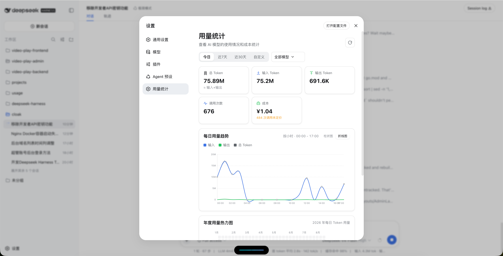
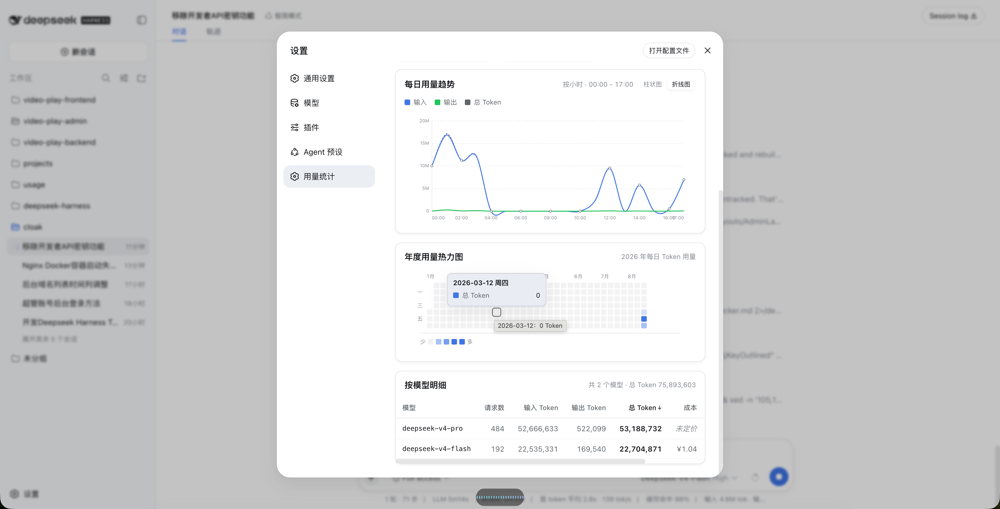

# dsh-plugin-usage

DeepSeek Harness 的 **Token 用量统计**插件（UI 参考 CC Switch 的「用量统计」功能）。

> A **token usage statistics** plugin for DeepSeek Harness, inspired by CC Switch's usage stats.
>
> GitHub: [bennett-dsh/dsh-plugin-usage](https://github.com/bennett-dsh/dsh-plugin-usage) · npm: `dsh-plugin-usage`

- 按天 / 自定义时间范围查看 Token 用量
- 按模型筛选，查看调用次数、输入/输出 Token、缓存命中、费用
- 可配置的每百万 Token 价格表（内置 DeepSeek 常见模型默认价，未配置的模型标记为「未定价」）
- 深/浅色主题自适应（使用 DSH 主题变量），无第三方图表库（手写堆叠柱状图）

> Features: daily / custom-range views · model filtering · call counts, in/out tokens, cache hits & cost · configurable per-million-token pricing (built-in defaults for common DeepSeek models; unpriced models are flagged) · dark/light theme via DSH tokens · zero chart dependencies (hand-written stacked bars).

## 功能特性 / Features

- 📊 **用量总览** — 总 Token、输入/输出 Token、调用次数、成本汇总卡片
- 📅 **时间范围** — 今日 / 近 7 天 / 近 30 天 / 自定义范围
- 🔍 **模型筛选** — 多选模型，按模型查看明细与占比
- 📈 **每日趋势** — 按天堆叠柱状图（输入=蓝、输出=绿），hover 查看明细
- 💰 **定价配置** — 为模型设置每百万 Token 价格（输入 / 输出 / 缓存命中 / 缓存创建），保存后立即生效
- 🌗 **主题自适应** — 跟随 DSH 深/浅色主题，无第三方图表库

## 效果图





## 安装与构建 / Install & Build

```sh
npm install        # 首次（devDependencies：typescript）
npm run build      # tsc 输出到 lib/，并生成 client 模块入口
```

### 通过官方命令安装（推荐）/ Install via the Official Command

插件已发布为 npm 包，使用 DSH 官方的插件管理命令安装：

```sh
dsh plugin --profile web add dsh-plugin-usage
dsh web            # 重启后生效
```

安装后 `dsh` 会检测到包的 `dsh.bundle` 声明，自动把 `dsh-plugin-usage` 加入
profile 的 `dsh.profile.bundles` 层栈，无需手动编辑任何配置文件。卸载 / 更新：

```sh
dsh plugin --profile web remove dsh-plugin-usage   # 卸载
dsh plugin --profile web update dsh-plugin-usage   # 更新
```

> 若 pnpm 因「发布时间过新」拒绝安装（`minimumReleaseAge` 校验），把
> `dsh-plugin-usage@<version>` 加入 profile 的 `pnpm-workspace.yaml` 的
> `minimumReleaseAgeExclude` 列表后重试（官方对新发布包同样采用此做法）。

### 从源码加载 / Load from Source

正式加载使用 patch 方式：把以下条目加入 `~/.dsh/profiles/web/cordis.patch.yml`（或使用 `--patch` 参数），路径替换为你本地的仓库路径：

```yaml
- insert:
  - id: usage-host
    name: '/path/to/dsh-plugin-usage/lib/host/index.js'
  - id: usage-client
    name: '/path/to/dsh-plugin-usage/lib/client/index.js'
```

然后启动：

```sh
dsh web --patch /path/to/dsh-plugin-usage/cordis.yml
```

开发期也可以在会话中通过动态插件（cordis_define）加载：Client UI 由 Host 的 `usage/client-source` RPC 从 `src/client/index.js` 实时读取并在浏览器中评估（UI 代码只有一份，改完刷新即生效）。

## 使用说明 / Usage

1. 打开设置（左下角）→ 左侧导航「用量统计」。
2. 顶部筛选：日期预设（今日 / 近 7 天 / 近 30 天 / 自定义）、模型多选。
3. 汇总卡：总 Token、输入 Token、输出 Token、调用次数、成本（未定价调用会在卡片下提示）。
4. 每日用量趋势：按天堆叠柱状图（输入=蓝、输出=绿），hover 查看明细。
5. 按模型明细表：请求数 / 输入 / 输出 / 总 Token / 成本 / 占比。
6. 「定价配置」区块：为模型设置每百万 Token 价格，保存后立即生效。

## 数据来源与口径 / Data Source

插件**不自己记录原始日志**，而是折叠 DSH 已持久化的会话日志：

- DSH 的 agent loop 会把每次模型调用的用量以 `assistant/message` 会话事件（携带 `usage`：输入/输出/缓存命中/缓存创建 Token 与 `message.source.{provider,model}`）写入会话日志（`~/.dsh/sessions/`）。
- 插件启动时**回填（backfill）全部历史会话**，之后每 2s 增量扫描活跃会话（内存），每 30s 增量扫描持久化会话（按 seq 水位）。
- 覆盖范围：所有 agent loop 调用（含子代理）。compaction / session-title 等辅助调用不写入会话日志，不在统计范围内。
- 费用 = `(输入×输入价 + 输出×输出价 + 缓存命中×缓存命中价 + 缓存创建×缓存创建价) / 1e6`，价格表可改。

> 动态插件形态下数据保存在进程内存中，重启后自动从会话日志重新回填，无需落盘文件。

## 源码结构 / Project Structure

```
src/
├── host/index.js     Host half：采集（扫描/回填）+ 聚合 + 价格表 + RPC（usage/query、usage/prices、usage/client-source）
├── client/index.js   Client half：设置页「用量统计」仪表盘（筛选/汇总卡/柱状图/模型表/定价配置），样式内联
└── client/styles.js  UI 样式源（构建脚本已合并进 index.js，可删除）
scripts/
└── build-client.js   构建时生成 lib/client/index.js 模块入口（同一份 UI 代码的正式加载形态）
cordis.patch.yml      bundle patch：`dsh plugin add` 安装后由 `dsh.bundle` 声明自动激活
```

## 说明 / Notes

- 插件名 `usage`；动态插件运行在会话级，卸载后统计重新回填即可恢复。
- 价格表修改在进程内有效（动态插件形态）；正式 patch 加载后可扩展为落盘持久化。

## 开源协议 / License

[MIT](./LICENSE)
